<picture>
  <source media="(prefers-color-scheme: dark)" srcset="docs/pic/logo-dark.png">
  
</picture>

Open-Box is a Wan Family project with two parts. The **router side** runs on a router / host and is an all-in-one transparent proxy: the package bundles Open-Box, the sing-box core, a Node runtime and the full GeoSite / GeoIP data, and after installation you set up subscriptions, nodes, routing, DNS and the firewall in a browser, with no configuration files to write by hand. The **clients** are the Open-Box apps for phones and computers; they pair with the router side at home and route traffic by the same rules when you are away.

**Open-Box's own programs are closed-source proprietary software, not an open-source project. Copying or distributing its own code, redistribution, decompilation and circumventing licensing are prohibited without permission.** Normal installation, offline use, upgrades, backups and restores are allowed; third-party open-source components keep their original licenses. See [LICENSE](LICENSE) and the [copyright scope](COPYRIGHT.md).

**Supported platforms**

Router side (one package and one install command; the script detects the system), see [Router side](#router-side):

- **OpenWrt** (including derivative firmware such as iStoreOS and ImmortalWrt): x86_64, aarch64; works as the main router or a side router, with a LuCI page
- **Debian / Ubuntu** (requires systemd; verified on Ubuntu 24.04): x86_64, aarch64; as a side router or for the local machine only, without LuCI or dnsmasq routing, see the Debian / Ubuntu section under [Installation](#installation)
- **Docker side router** (Linux Docker Engine): x86_64, aarch64; the container gets its own LAN IP through macvlan / ipvlan L2, with one-command install, offline images and `docker run`; new installs default to port 3036 and upgrades keep the existing port, see the [Docker deployment guide](docker/README.md)

Clients (Open-Box App, the same interface and features on all four platforms), see [Clients](#clients):

- **Android phones**: Android 12 or later, 64-bit ARM, see [Android client](#android-client)
- **macOS computers**: Apple silicon (M1 or later), macOS 14 or later, see [macOS client](#macos-client)
- **Windows computers**: Windows 10 / 11 64-bit, see [Windows client](#windows-client)
- **Linux computers**: Ubuntu 22.04 / 24.04, Debian 12, 64-bit x86, see [Linux client](#linux-client)

## Router side

Open-Box installed on a router / host: a panel in the browser plus the sing-box core, routing traffic for the devices on the LAN.

### Interface

**Overview**: latency and recent trend for the four test sites, real-time charts of connections / memory / traffic, domain filtering stats and monthly traffic insights, all on one page.

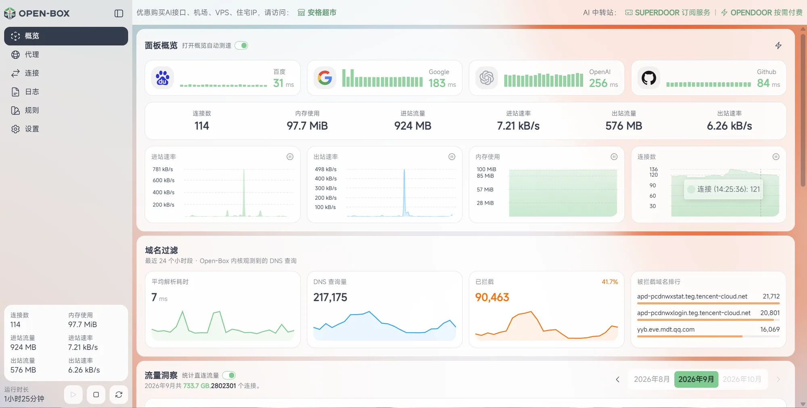

**Proxies → Policy group**: one card per site set, showing the current route and node health at a glance.

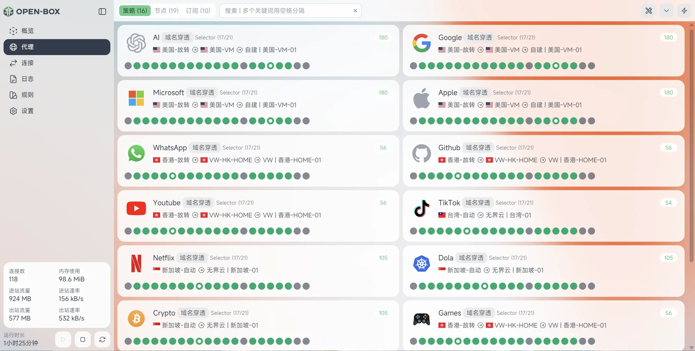

**Domain Drill**: expand a policy to see the full chain of site set, node group and the actual node.

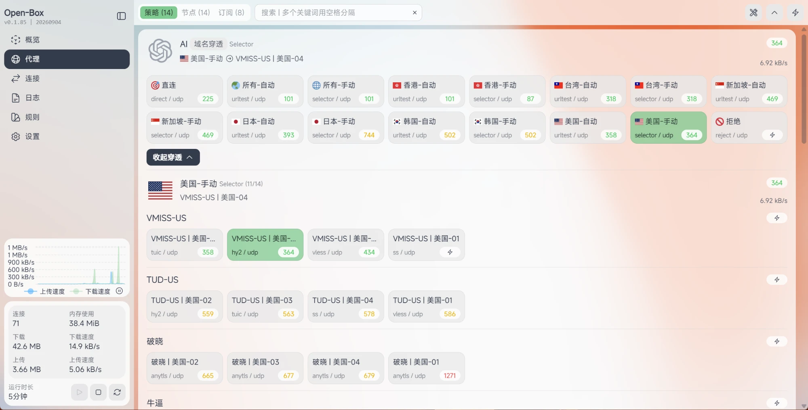

**Rules → Actual route**: enter a domain to preview the rule match, and make a real request to see the route, DNS and the rule that matched.
"LAN client" temporarily attaches a virtual interface with its own MAC to the LAN bridge, so it enters the router through the ingress the way a real device would. On virtualization platforms such as ESXi, set the port group's security policy "Promiscuous mode" to Accept, otherwise the virtual client cannot be created (the panel tells you; it does not silently fall back to core diagnostics).

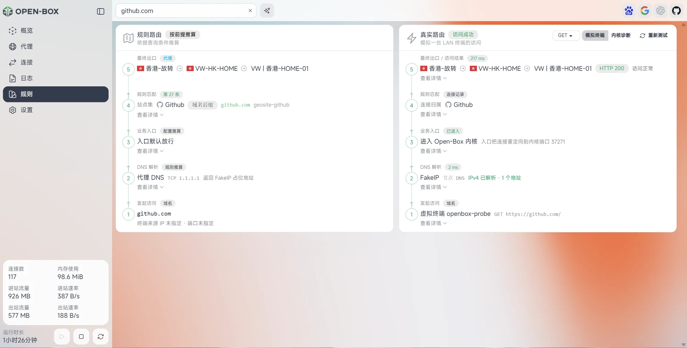

**Subscriptions**: supports Clash YAML, base64 share links and common sing-box share links; the subscription sharing area can be expanded or collapsed, and share links support QR codes, copying and enabling/disabling.

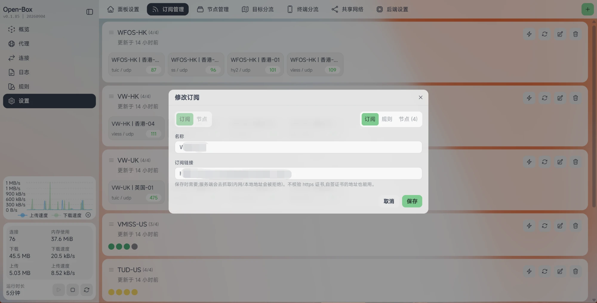

**Outbound nodes**: auto-select groups and manual-select groups can be mixed, and dynamic groups automatically pick up new nodes by keyword.

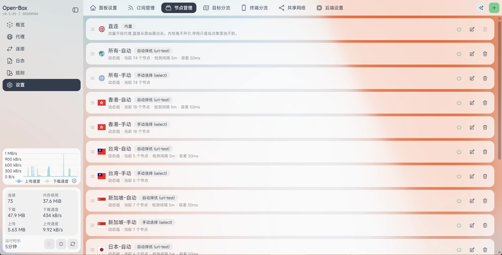

**Destination routing**: site sets support matching by domain, domain suffix, keyword, IP range, rule set and rule set link. Site sets are matched top-down, and the first match wins. **IP conditions only handle IPs, and domain conditions only handle domains**, for both the pre-route rule and site sets: a request with a domain is matched by domain conditions only; if none match, it goes to the fallback "Other" and uses Other's exit, and the resolved IP is never checked against any IP range or geoip. IP conditions only apply to connections made directly to an IP for which the core cannot identify a domain. This keeps DNS and the connection on the same side: domains that fall back to direct are resolved with the direct DNS and also connect directly; to send a site through a node, add its domain to the relevant site set or to the pre-route rule. The built-in private network direct rule and "Direct for subscription & node hosts" are not part of routing and apply to every connection.

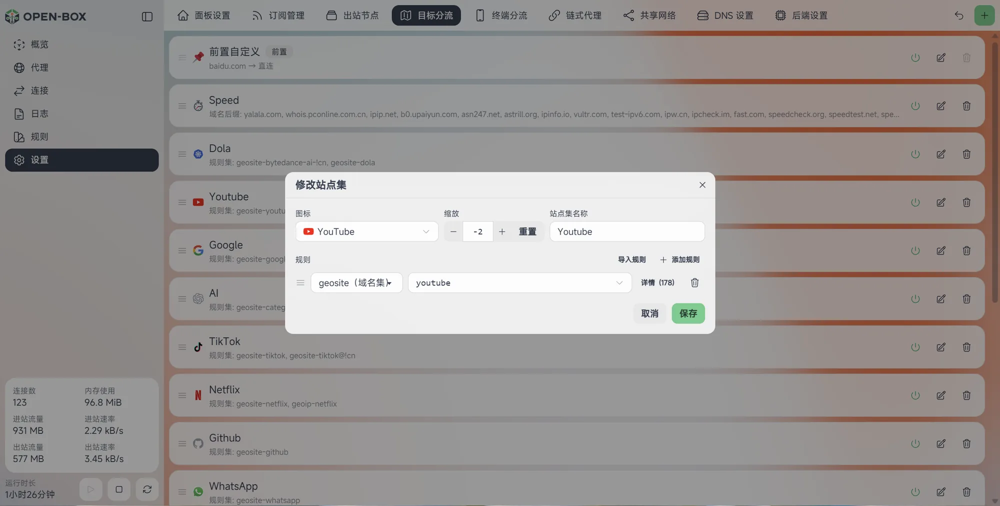

**Chain proxy**: assign an upstream node or node group to exits such as residential / static IPs; while editing you can run a speed test and see the exit IP and its location.

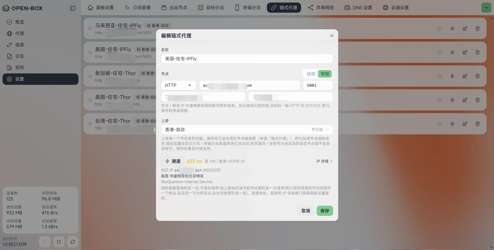

**Backend**: IPv6, test URLs, the core service and unified component upgrades are all managed here. Automatic speed tests honor each policy's configured test interval; within the interval the same node reuses its existing result, and on timeout it retries immediately or switches according to the policy.

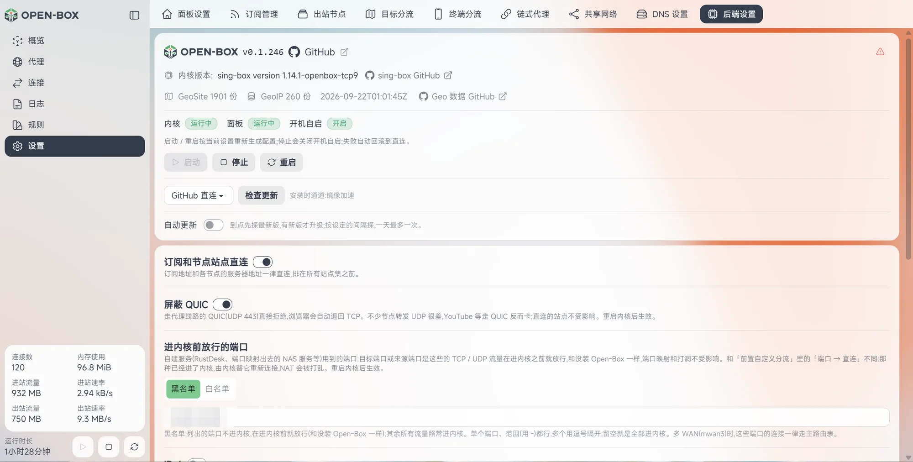

**Opening the panel on a phone**: the same panel; on narrow screens it switches to a one- or two-column layout with bottom navigation (for the phone app, see [Clients](#clients)).

<p>
  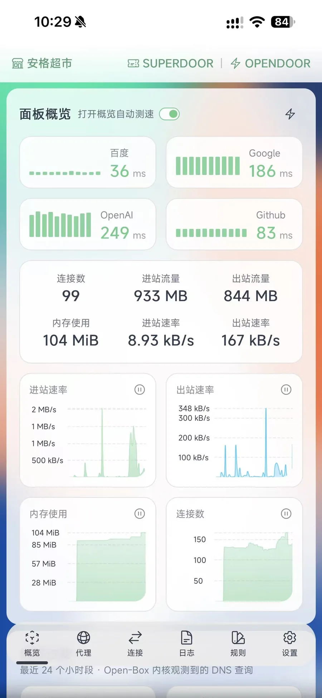
  
</p>

### Main features

- **Per-profile client settings**: whichever profile you select, the app uses the test sites, test URL, timeout and latency color thresholds synced from that profile's router; node groups keep their own test interval, tolerance and success status codes. Local preferences such as language, theme, Pause VPN on trusted Wi-Fi and per-app routing are also saved separately, so switching profiles never borrows another profile's settings. Upgrades migrate existing preferences automatically.
- **Client direct DNS**: under "Settings → App", choose whether direct DNS uses the current network (default) or the router's direct DNS that comes with the profile; it takes effect after syncing. Synced profiles and content filtering snapshots keep working offline.
- **Content filtering rule management**: manage rules, script snapshots and their enabled state under "Settings → App → Content filtering"; three default snapshots are built in: "Combined Data Saver", "Youtube-Surge" and "Youtube-Patch". Rules sync with the profile to iOS clients that support content filtering and are enforced on the phone; they work offline, and a failed update keeps the old snapshot. Upgrades keep existing rules and the user's edits, disabled and deleted states, and backup and restore also include rules and scripts. On the phone you still need to turn on content filtering yourself and trust the certificate.
- **Subscriptions and nodes**: supports Clash configs, base64 node shares and protocols including shadowsocks, vmess, vless (including REALITY), trojan, hysteria2 (including port hopping), tuic, anytls and wireguard. Node naming follows Open-Box's renaming rule: a renamed node uses its new name, otherwise the original name is kept.
- **Node groups**: provides auto-select (url-test), manual select (select) and failover groups; dynamic groups follow subscription updates by keyword (chain proxies are not added to dynamic groups; to use one, add it to a static group), and static groups let you pick nodes by hand. Failover groups rank priority with primary and backup tabs: traffic switches to the backup only when the primary is down, and switches back when the primary recovers. Test results for auto-select, failure rechecks and failover are recorded separately per node, test URL and success status code; after a failure the result is kept for a 10-second recheck, so different test targets do not affect each other.
- **Chain proxy**: assign an upstream node or node group to an exit such as a residential / static IP (socks5 / http / https; paste a link or fill in the fields), so traffic goes through the upstream first and then to the exit; once created, it works as a normal node in node groups, site sets and Client routing.
- **Destination routing**: rules can be entered directly or added as rule set links. Rule set links and local rule entries can be kept and active at the same time; importing entries does not delete the original link. Rule set links are updated every 24 hours when the core starts; "Update now" next to a link refetches it immediately, and the core loads the new content automatically.
- **Switching without restarting the core**: when a site set switches between direct and proxy, only a tiny "switch rule set" is rewritten and the core does not restart: established connections stay up (downloads, video and SSH are unaffected), and new connections and DNS follow the new route within 1 second. A redeploy and one core restart happen automatically only when the device has no nftables redirect (pure tun), when the switch also affects the entry bypass, or when routing settings have changed but the core has not been restarted yet.
- **TUN parameters**: in Backend you can change the tun stack (mixed / gvisor / system), the MTU, and the MSS clamp for TCP connections made by the core itself. On devices with hardware flow offloading enabled, such as the MT6000, choose gvisor as the stack if large files get corrupted over a direct wired connection.
- **Block QUIC**: a switch in Backend (on by default). QUIC (UDP 443) on proxy routes is rejected and browsers fall back to TCP automatically; direct sites are unaffected. Many nodes forward UDP poorly, and sites such as YouTube actually stutter over QUIC, so it is on by default; turn it off if your nodes handle UDP well.
- **Rule set import**: in the site set edit window, click "Import rules", enter a rule list URL, preview the parsed result, then import entries such as domains, domain suffixes, keywords and IP/CIDR into the site set. Imported entries are stored locally, so startup no longer depends on that remote rule link.
- **Subscription sharing**: choose the nodes to share, set a title and domain/IP, and use HTTP or HTTPS as the protocol prefix; save once to generate the link and close the window. The share list can be expanded/collapsed, and each share can be enabled or disabled, copied, refreshed and deleted.
- **DNS takeover**: three modes are supported: dnsmasq forwarding, firewall hijack and off; domestic domains and proxied domains can be resolved separately. On the DNS page, first choose whether the router is in "Mainland China" or "Outside mainland China" (Hong Kong, Macau and Taiwan count as "Outside mainland China"; on a new install, an upgrade, or clicking "Restore defaults", this is detected automatically from the egress public IP, and you can also switch it manually). Upstreams on both sides can have their address and protocol (UDP / TCP) changed, or you can choose "Upstream DNS" (the DNS assigned by DHCP or set manually on the router's interface): "Direct DNS" is for direct domains and defaults to Upstream DNS; "Proxy DNS" is for proxied domains: in mainland China it defaults to TCP 1.1.1.1 and cannot use Upstream DNS (DNS in mainland China poisons answers for foreign domains), and outside mainland China it defaults to Upstream DNS. Which route Proxy DNS takes is decided by Destination routing based on its address, the same as when a LAN device accesses that address (for example, 1.1.1.1 falls under "Overseas", so it uses whatever route "Overseas" has selected at the moment); Upstream DNS always goes direct. Which upstream a domain uses is determined by the current exit of its site set, with no separate configuration; to pin a domain to an IP or to another domain, use "DNS rewrites". With domain filtering on, "Domain resolution queries" lists each query and the device that made it (IP plus name); in dnsmasq mode, devices are identified from dnsmasq's query log (the log is written to memory and the panel clears it as it reads, so it does not go into logread), and queries dnsmasq answers from its cache are recorded too.
- **Entry bypass**: the "Direct traffic bypasses the core" switch in Backend (on by default) controls the whole thing; when it is off, all traffic enters the core, so direct traffic shows up on the Connections page and in traffic stats, at the cost of direct traffic also being forwarded through the core. When it is on, one of two modes is chosen automatically, with nothing to configure. **Default bypass** (when FakeIP is on and the fallback goes direct): proxied domains get placeholder addresses and always enter the core; any other destination whose resolved address is not on the "enter core" list (the IP sets of site sets that go through a proxy or are rejected) is let through directly at the system entry (nftables), so destinations that fall back to direct or go direct by domain no longer pass through the core. **Default into core** (all other cases): only the IP sets of site sets currently going direct (by default geoip-cn and others in "Domestic") are let through at the entry, and ranges that overlap with proxied sets are subtracted before being let through. Switching between the two modes, and flipping between direct and proxy, only rewrites a few rule set files; the core does not restart. Which mode is active and why is shown in the "Entry" step on the Rules page. **Direct answer bypass** (in default bypass mode): the entry only sees IPs, and direct sites hosted on CDNs such as Cloudflare (for example speed-test sites, or sites that fall back to direct) have addresses that fall inside proxied sets, so the entry cannot tell the domain apart. Before passing DNS answers for direct site sets and fallback-direct domains to the device, the core first writes any addresses that would be sent into the core into an entry bypass set with a timeout, so by the time the device gets the address the connection is already let through at the entry, and even the first connection does not enter the core. Bypassed addresses are kept for the DNS answer's cache time (at least 15 minutes, at most one day); they are saved when the core restarts and written back with the remaining time once it is up. When a site set switches from direct to proxy / reject, or routing settings change, the whole set is cleared and rebuilt (along with the dnsmasq cache); when switching from proxy back to direct, only the addresses that no longer need to bypass are removed. Closing a connection on the "Connections" page, or restarting the core, also clears the system's tracking entry for that connection, so long-lived UDP connections stuck in the core are re-evaluated under the current rules. **Direct clients**: when a device is set to "Direct" in Client routing, the first packet of each of its new connections is pre-checked by the core against the rules; if it does not hit the proxy / reject IP ranges, rule sets or ports in the pre-route rule, it is let through at the entry and the whole connection skips the core (connections that would not enter the core anyway are not pre-checked, and multi-WAN line selection is unaffected); its DNS queries are also handed to the core and answered for that device, so it gets the real addresses from direct resolution, in dnsmasq mode as well. Devices set to "Bypass kernel" also get per-device DNS answers; if one does get a FakeIP placeholder address, the connection enters the core as usual and still works. Node server addresses in "Direct for subscription & node hosts" are likewise pre-checked on the first packet and let through at the entry, so LAN devices connecting directly to node servers do not go through the core. Limits of default bypass mode: after a site set switches from direct to proxy, real IPs still unexpired in a device's local DNS cache will keep going direct; real IPs cached by devices using their own DoH, or cached before FakeIP was turned on, are likewise not covered.
- **Share network**: opens the core's inbounds to other devices on the LAN for use as a proxy.
- **Tailscale networking**: under "Settings → Tailscale", join the router to a Tailscale network (official control server), share the local LAN subnets and enter the subnets shared from other locations, so devices at every location can reach each other by LAN IP without installing anything. The auth key is generated in the Tailscale admin console, and shared subnets take effect only after they are approved there; subnets at different locations must not overlap. The auth key is not included in export files and is not synced to clients. Changes take effect after restarting the core.
- **Export & import**: packs routing, site sets, node groups, DNS and panel settings into one file, optionally including subscriptions and nodes, chain proxies, Client routing and Share network; import it on a new device and restart the core. The file does not include the panel password.
- **Traffic stats**: view daily traffic by device, node and destination.
- **Content filtering rule restore**: under "App → Content filtering", click "Restore defaults" to restore the three built-in rule sets offline; rules you added yourself are kept, and after restoring, sync on the phone.
- **Built-in rule database**: the full package ships with GeoSite / GeoIP data, so no separate rule database download is needed on first install or startup. v0.1.335 includes the data as of 2026-10-16 (1,917 GeoSite and 260 GeoIP lists), searchable by Simplified Chinese, Traditional Chinese and English descriptions.
- **Component upgrades**: the Open-Box program, the sing-box core and the GeoSite / GeoIP data are all fetched from this repository's Releases. Before upgrading, local versions and file integrity are checked; if the version matches and the files are intact, nothing is downloaded again. The full package always includes all three components, so new installs do not need to download the rule database separately.
- **LuCI fallback page**: when the panel will not open, you can start/stop the service, restore direct connection or uninstall from the router's "Services → Open-Box" page.

### Download

Download the full package for your architecture from [GitHub Releases](https://github.com/wan-family-office/open-box-releases/releases/latest):

- `x64`: x86_64 routers / hosts
- `arm64`: aarch64 routers / hosts

For client packages, see [Clients](#clients).

The same package installs on both OpenWrt and Debian / Ubuntu (systemd); the install script detects which one it is on (see the end of [Installation](#installation)).

The full package contains Open-Box, sing-box, the Node runtime and all GeoSite / GeoIP data. Every asset has a SHA256 checksum file next to it.

When used as a side router (devices point their gateway / DNS at the machine running Open-Box), turn on "IP masquerading" (MASQUERADE) for the side router's LAN zone; otherwise replies from direct sites do not pass back through the side router and connections do not match up, which shows up as foreign sites working while mainland China sites will not open.

### Installation

Log in to the OpenWrt router over SSH as root and run:

```sh
curl -fsSL https://raw.githubusercontent.com/wan-family-office/open-box-releases/main/scripts/install.sh | sh
```

If GitHub is hard to reach, first get the install script through a reachable raw mirror, then have the script use the mirror to download the release package:

```sh
curl -fsSL https://gh-proxy.com/raw.githubusercontent.com/wan-family-office/open-box-releases/main/scripts/install.sh | sh -s -- --mirror
```

`--mirror` only controls the package download; if the outer `raw.githubusercontent.com` itself is unreachable, appending `--mirror` to the original URL still cannot fetch the script.

During installation you are asked once for the panel port (default **3036**; just press Enter). The port is checked first: if another program is using it, or it conflicts with Open-Box's own or the system's ports, the reason is shown and you are asked to enter another. You can also set it directly with `--port`, for example by appending ` --port 3080` to the command above. You can still change it after installation, see [Change the panel port](#change-the-panel-port).

Requirements: OpenWrt (iStoreOS 22.03, OpenWrt 22.03 and older firmware are too old to install on; upgrade to iStoreOS 24 / OpenWrt 24 or later first), x86_64 or aarch64, at least 512MB of storage and 512MB of RAM. The install / upgrade scripts check for and try to fill in system dependencies with opkg or apk (kmod-tun, kmod-nft-queue, kmod-nft-nat, kmod-veth, ip-full, ca-bundle); if the package feeds are unreachable they only warn and do not abort, so you can install them manually later as prompted; set `OPENBOX_SKIP_DEPS=1` to skip this step. After installation, open the `http://<router LAN IP>:<panel port>` address printed by the script in a browser and set an admin password on first visit.

After installation, open `http://<router LAN address>:<panel port>` in a browser (the install script prints this address at the end), and **set the panel password on first visit**. If you forget the password later, there is no need to reinstall, see [Forgot the panel password](#forgot-the-panel-password) below.

#### Debian / Ubuntu

The same install, upgrade and uninstall commands also work on Debian / Ubuntu (requires systemd; verified on Ubuntu 24.04); run them as root or with `sudo`. The script detects the system: services are handed to systemd (`openbox.service` for the core, `openbox-panel.service` for the panel), the `open-box` command goes in `/usr/local/bin`, and since the bundled Node is the musl build used on OpenWrt, installation downloads the official glibc build of the same version from nodejs.org (or npmmirror if that is unreachable) to replace it, so the machine needs access to one of them. Dependencies are filled in with apt (nftables, xz-utils, iproute2, ca-certificates); the tun / nftables kernel modules come with the distribution kernel.

Differences from OpenWrt:

- No LuCI page and no dnsmasq routing mode: DNS has only "Firewall hijack" and "Off". If the local machine uses systemd-resolved, its upstream queries are taken over by the core as well, with no need to change resolved's configuration.
- You manage the firewall yourself: the script writes no allow rules. If you have ufw / firewalld or similar installed, allow the panel port yourself, and (as a side router) forwarding from the LAN to this machine.
- The core turns on IP forwarding when it starts (`net.ipv4.ip_forward=1`; if it was off before, it is turned back off when the core stops), so LAN devices that point their gateway / DNS at this machine get routed through it; if it is for the local machine only, you can ignore this.
- For troubleshooting, see `journalctl -u openbox -u openbox-panel`; to restore direct connection in an emergency, run `systemctl stop openbox`.

### Change the panel port

New installs default to port **3036**; **machines installed with v0.1.216 or earlier keep their port after upgrading** (still 2026) and are not moved to the new default.

Two ways, same result:

- **LuCI page**: router admin interface → Services → Open-Box; on the "Open-Box panel" card, click "Change port" at the end of the button row. Enter the new port and save; if there is a conflict it is not saved and you are told why, and if the panel is running it restarts once automatically.
- **SSH**: `open-box port` shows the current port, and `open-box port 3080` changes it to 3080.

Afterward, remember to open the panel at the new address.

### Forgot the panel password

The panel password is stored on the router, so anyone who can log in to the router as root can look it up; **no reinstall is needed, and subscriptions and rules are not lost**. There are two places to see it:

**1. LuCI page**: router admin interface → Services → Open-Box; in the "Full management lives in the Open-Box panel:" line at the top of the page, the password is shown as `Password: xxxx` right after the panel address. If you do not see it right after upgrading, log out of LuCI and log in again.

**2. SSH command**: after logging in to the router over SSH, run `open-box` and choose `1`:

```text
root@OpenWrt:~# open-box

Open-Box v0.1.216
  1) 当前密码
  2) 重新启动
  3) 检查升级
  4) 卸载
  5) 退出
请选择 [1-5]: 1

  面板地址: http://192.168.1.1:3036
  当前密码: ********
```

If you only want the password itself, run `open-box password` directly; `open-box check` checks for a new version, `open-box update` upgrades directly, `open-box restart` restarts the core and the panel, and `open-box uninstall` uninstalls.

Both entry points are available from **v0.1.210**. On older versions, first upgrade to the latest version over SSH with the command in the "Upgrade" section below (upgrading keeps the password, subscriptions and rules); after that the `open-box` command is available.

To change the password after finding it: log in to the panel and click "Change password" on the "Settings" page.

### Upgrade

In the panel you can check for updates under "Settings → Backend", or run this over SSH (the same command for OpenWrt and Debian / Ubuntu):

```sh
curl -fsSL https://raw.githubusercontent.com/wan-family-office/open-box-releases/main/scripts/update.sh | sh
```

Upgrading keeps subscriptions, rules and the panel password, and verifies the Open-Box, sing-box and GeoSite / GeoIP components. Identical, intact components are reused directly; only changed, missing or damaged components are downloaded from this repository's Releases.

#### Roll back to the previous version

If the panel or core misbehaves after an upgrade, you can roll back with the command below: the script looks up on GitHub the most recent stable Release before the current version and downloads and reinstalls that version's full package. The router does not keep a local backup of the old version, so rolling back requires access to GitHub (or a mirror); data directories such as subscriptions, rules and the panel password are left untouched.

```sh
curl -fsSL https://raw.githubusercontent.com/wan-family-office/open-box-releases/main/scripts/update.sh | sh -s -- --rollback --direct
```

If GitHub is hard to reach, run it through a proxy:

```sh
curl -fsSL https://gh-proxy.com/raw.githubusercontent.com/wan-family-office/open-box-releases/main/scripts/update.sh | sh -s -- --rollback --mirror https://gh-proxy.com
```

Both commands detect the router architecture automatically, download the previous version's full package, verify its SHA256 first, and then replace the current files; if verification or replacement fails, the existing installation is kept. --mirror only affects the package download; the GitHub API used to query the Release list is tried directly first and goes through the mirror only if the direct connection fails.

### Uninstall

By default, this stops the service and keeps subscriptions and configuration data:

```sh
curl -fsSL https://raw.githubusercontent.com/wan-family-office/open-box-releases/main/scripts/uninstall.sh | sh
```

To delete the data as well:

```sh
curl -fsSL https://raw.githubusercontent.com/wan-family-office/open-box-releases/main/scripts/uninstall.sh | sh -s -- --purge
```

## Clients

The Open-Box App brings the routing rules of your home router side to phones and computers: away from home, traffic is still routed by the same rules, and the core inside the App is the same sing-box as on the router side. Android, macOS, Windows and Linux share the same interface and features:

- **Node routing**: in the panel under "Settings → App", scan the Share network server's code in "Node routing (app)" (paste the link on a computer). The App picks a set of rules based on your region ("Region routing", which can locate you automatically); domestic sites connect directly from where you are, and everything else goes out through your home router; the router needs a public IP.
- **Local routing**: scan the code in the panel's "Local routing (app)" (paste the link on a computer), or import the file exported there. The router's subscription nodes, node groups, Destination routing and chain proxies are imported into the App as a whole, and the App does its own routing without going through the router; when you change the configuration on the router, sync in the App to catch up, and subscriptions refresh on schedule on the device itself.
- **Same routing as the router**: traffic set to direct does not enter the core; the "Traffic" page shows which route each connection takes and the core logs, and on the "Route" tab you enter a URL to see which rule it matches (Rule route) and how it actually goes when accessed (Actual route).
- **Other**: automatically pause the VPN on specified Wi-Fi (for example when you get home), an IPv6 switch, Simplified Chinese / Traditional Chinese / English, light / dark theme.

The packages are all on [Releases](https://github.com/wan-family-office/open-box-releases/releases): `open-box-android-<version>.apk`, `open-box-macos-<version>-arm64.dmg`, `open-box-windows-<version>-x64-setup.exe`, `open-box-desktop-linux-<version>-amd64.deb`; you can also click them directly in "Client downloads" at the top of the panel's "Settings → App". Clients are released only when they have updates; if the latest release does not include them, the "Client downloads" section at the end of its release notes links to the latest packages, or you can look back through the Releases list.

### Android client

- **Requirements**: Android 12 or later, 64-bit ARM.
- **Install and upgrade**: download the latest `open-box-android-<version>.apk` from [Releases](https://github.com/wan-family-office/open-box-releases/releases) (or tap the Android icon in "Client downloads" under the panel's "Settings → App") and install it manually the first time (the system will ask you to allow installing apps from the browser / file manager); after that, upgrade with one tap under "Settings → Check for updates" in the App.

Home (Node routing), Proxies → Policies (Local routing), Traffic → Route, Settings:

<p>
  
  
</p>
<p>
  
  
</p>

### macOS client

The App stays in the menu bar, and quitting it disconnects the VPN; Settings has a launch-at-login switch (off by default).

- **Requirements**: a Mac with Apple silicon (M1 or later), macOS 14 or later.
- **Install**: download the latest `open-box-macos-<version>-arm64.dmg` from [Releases](https://github.com/wan-family-office/open-box-releases/releases) (or click the macOS icon in "Client downloads" under the panel's "Settings → App"), open it and drag Open-Box into "Applications". The App has no Apple developer signature, so the first launch says it cannot be verified: go to the bottom of "System Settings → Privacy & Security" and click "Open Anyway" (from macOS 15, right-clicking "Open" no longer gets around it). The first launch also asks for your computer password once to install a background service (used to set up the VPN and change the system DNS, restored automatically after disconnecting).
- **Upgrade**: upgrade with one tap under "Settings → Check for updates" in the App, without clicking "Open Anyway" again; if the background service has changed, you will be asked for your computer password again.
- **Uninstall**: App "Settings → Uninstall Open-Box".
- "Pause VPN on trusted Wi-Fi" requires allowing the App to use location (macOS only gives the Wi-Fi name to apps with location permission).

Home (Node routing), Proxies → Policies (Local routing), Traffic → Route, Settings:

<p>
  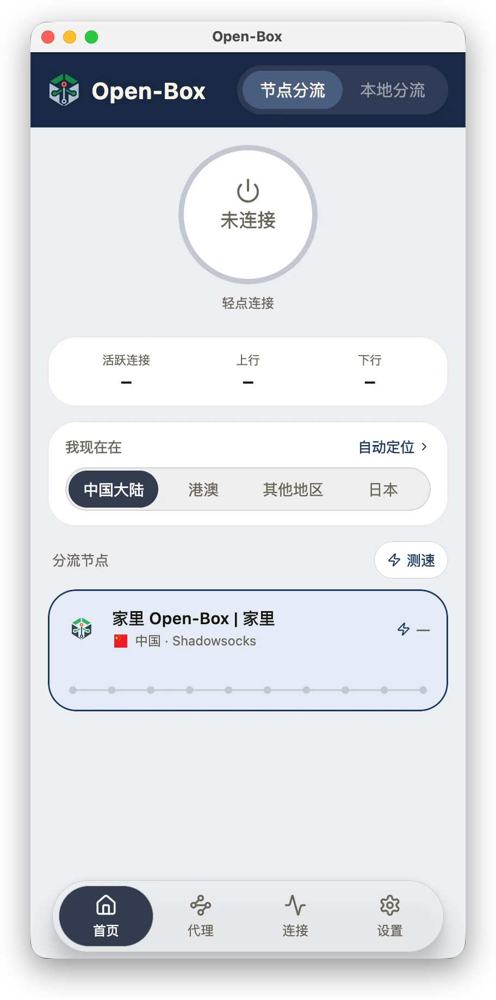
  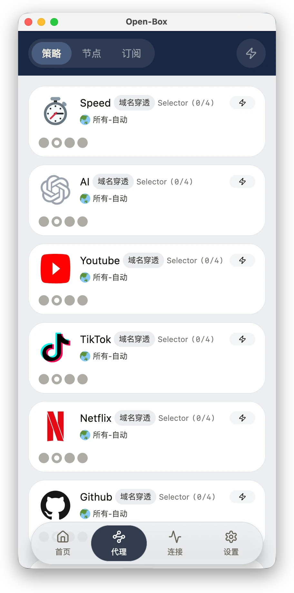
</p>
<p>
  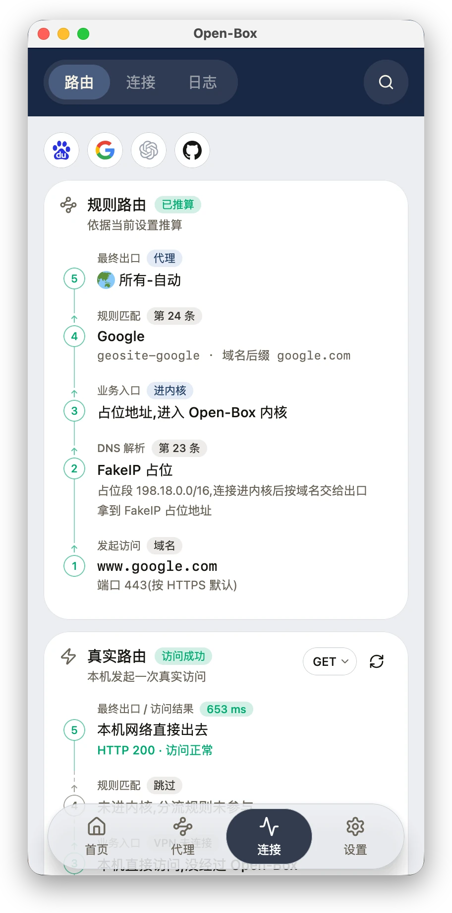
  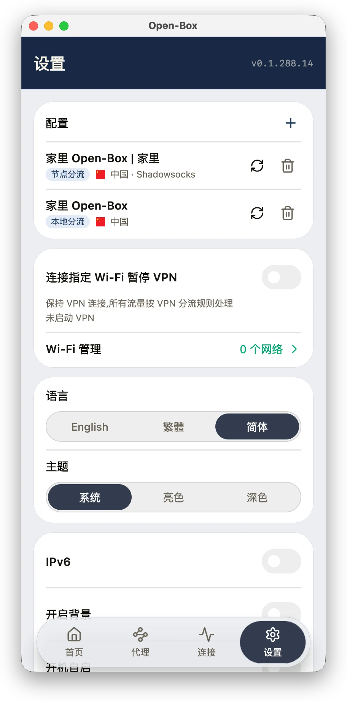
</p>

### Windows client

The App stays in the system tray at the bottom right: closing the window keeps it running in the background, left-clicking the icon opens the window, and the right-click menu lets you connect / disconnect and quit; quitting the App disconnects the VPN. Settings has a launch-at-startup switch (off by default).

- **Requirements**: Windows 10 / 11, 64-bit.
- **Install**: download the latest `open-box-windows-<version>-x64-setup.exe` from [Releases](https://github.com/wan-family-office/open-box-releases/releases) (or click the Windows icon in "Client downloads" under the panel's "Settings → App") and double-click it to install. The installer has no code signature, so running it shows "Windows protected your PC": click "More info → Run anyway", then click "Yes" in User Account Control. Installation also installs a background service (used to set up the VPN).
- **Upgrade**: upgrade with one tap under "Settings → Check for updates" in the App: click "Yes" once in User Account Control, and the App reopens automatically after installing.
- **Uninstall**: App "Settings → Uninstall Open-Box", or uninstall Open-Box under Windows "Settings → Apps → Installed apps".
- On Windows 11 24H2 and later, "Pause VPN on trusted Wi-Fi" requires turning on location services and allowing desktop apps to access location under "Settings → Privacy & security → Location" (Windows only gives the Wi-Fi name to apps with location permission).

Home (Node routing), Proxies → Policies (Local routing), Traffic → Route, Settings:

<p>
  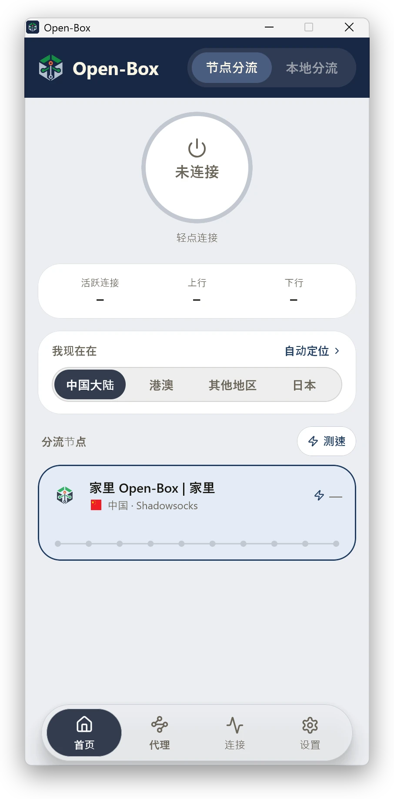
  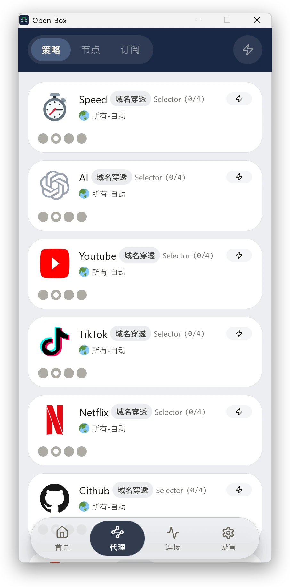
</p>
<p>
  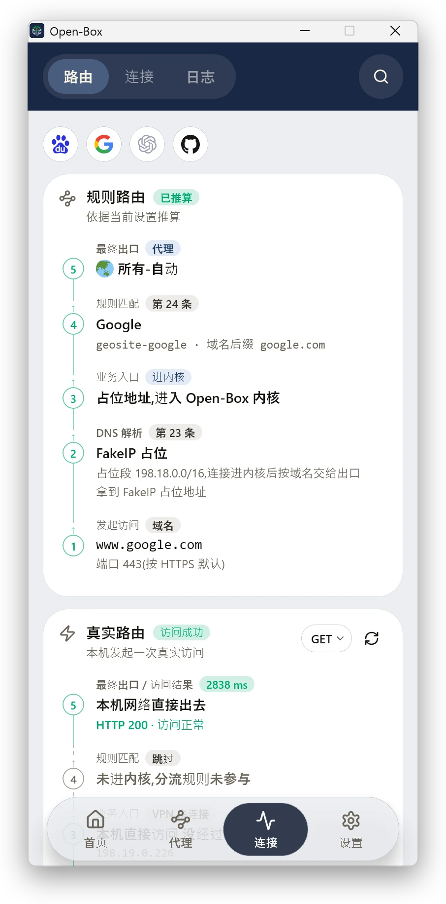
  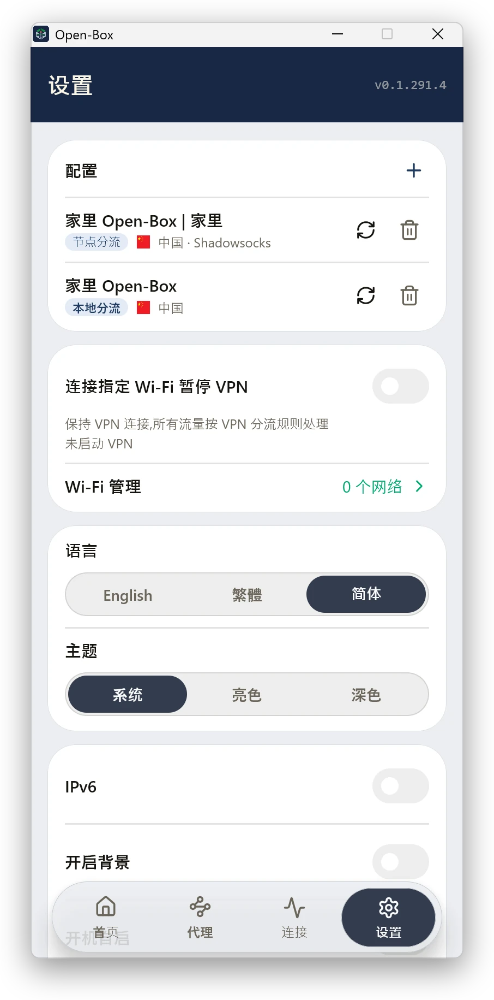
</p>

### Linux client

Closing the window keeps the App running in the background; the tray icon menu in the top bar lets you open the window, connect / disconnect and quit; quitting the App disconnects the VPN. Settings has a launch-at-login switch (off by default).

- **Requirements**: Ubuntu 22.04 / 24.04, Debian 12, 64-bit x86 (amd64), GNOME or KDE desktop. GNOME needs the AppIndicator extension to show the tray icon (built into Ubuntu; on Debian install `gnome-shell-extension-appindicator`); without a tray, open Open-Box again from the app list to get back to the window.
- **Install**: download the latest `open-box-desktop-linux-<version>-amd64.deb` from [Releases](https://github.com/wan-family-office/open-box-releases/releases) (or click the Linux icon in "Client downloads" under the panel's "Settings → App"), run `sudo apt install ./open-box-desktop-linux-<version>-amd64.deb` in the download directory, and once installed, open Open-Box from the app list. Installation also installs a background service (used to set up the VPN and take over the system DNS, restored automatically after disconnecting).
- **Upgrade**: upgrade with one tap under "Settings → Check for updates" in the App, with no password needed; the App reopens automatically after installing.
- **Uninstall**: App "Settings → Uninstall Open-Box", or run `sudo apt purge open-box-desktop`.
- If the router-side Open-Box (Debian / Ubuntu version) is installed on the same computer and its core is running, the App will not connect; stop the core in its panel first.

Home (Node routing), Proxies → Policies (Local routing), Traffic → Route, Settings:

<p>
  
  
</p>
<p>
  
  
</p>

## License

This is Wan Family's public Open-Box release repository: it provides the official releases, the install / upgrade / uninstall and Docker deployment scripts, and the documentation. The source code is not published here. Open-Box's own programs are governed by the root [LICENSE](LICENSE); copying or distributing, redistribution, decompilation, making renamed derivative products and circumventing licensing are prohibited without permission. Upstream zashboard's MIT code, the sing-box core and other third-party components remain under their respective open-source licenses; for the license scope and historical license notes, see [COPYRIGHT.md](COPYRIGHT.md).
